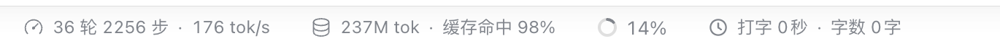

# dsh-doki · 打字统计

[](https://www.npmjs.com/package/dsh-doki)
[](./LICENSE)

一个给 DeepSeek Harness Web UI 用的输入区统计插件：在输入框下方的环境行里，紧跟在「上下文」指示器后面显示统计数字。视觉与交互和它左边的「会话统计」「Token 用量」两个模块同构 —— 同样的 14px 图标 + 等宽数字的 pill，点击展开一个明细弹层。

```
10 轮 484 步 · 129 tok/s    37M tok · 缓存命中 95%    8%     ◷ 打字 2秒 · 字数 10字
                                                              └── 本插件（pill）──┘
```



底栏只放几个一眼要看的数字（默认是打字时间、累计字数），「思考」收进点击后展开的弹层里，所以这一行的长度和宿主那两条 pill 相近。想多要几项时，在「设置 → Dock 设置」里打开就行：除了这三项，还有两项取自官方会话统计的 **耗时**（LLM + 工具累计）与 **首字**（平均首字延迟，TTFT），默认关闭、开了才显示。

## 五项指标的口径

前两项在底栏常显，「思考」在弹层，最后两项取自官方会话统计、默认关闭。

| 指标 | 显示位置 | 含义 | 计算方式 |
| --- | --- | --- | --- |
| **打字** | 底栏 | 真正在敲键盘的时长 | 相邻两次真实编辑的间隔累加；间隔超过 `GAP_LIMIT_MS = 2000ms` 视为停顿，不计入 |
| **字数** | 底栏 | **累计输入的有效字数** | 每次草稿变化时，把新旧文本按码点做前后缀 diff，只累加**新增**的字符数。删除不减、清空不减、改回原文不重复计；拼音候选阶段完全不计，选词上屏后才按上屏的中文字数计；零宽字符与 `@` 引用占位符（`\uE100-\uE11D` / `\uFFFC`）不计 |
| **思考** | 仅弹层 | 光标在输入框但没打字的时间 | 每 `TICK_MS = 1000ms` 检查一次：焦点在 composer 内、且距上次编辑已超过 `IDLE_AFTER_MS = 1000ms`，则该秒计入 |
| **耗时** | 可选（默认关） | 本会话的累计耗时 | 官方 `sessionStats` 投影的 `llmMs + toolMs`；投影缺失或类型不符时整格不出现 |
| **首字** | 可选（默认关） | 平均首字延迟 | 官方 `sessionStats` 的 `ttftMs / ttftSteps`；`ttftSteps === 0`（还没生成过）时不出现 |

- 「有打字」的判定用 `InputState.draftRev`（只在草稿真正变化时推进，移动光标、开菜单都不算），不监听 DOM 输入事件。
- 「字数」是累计值而不是输入框当前长度：打 10 个字再全删掉，仍然显示 10 字。这样一整个会话真正敲了多少字是可以看到的。
- 累计用的 diff 是前后缀 diff：`ab` → `abcd` 记 2；`abcd` → `ab` 记 0；全选替换 `abcd` → `xy` 记 2。粘贴同样按新增字符计。换行只是排版、不计。
- 拼音输入法组合期间（`compositionstart`→`compositionend`）计数冻结，`compositionend` 后从编辑器 DOM 重新采样一次真实文本再记一次增量（用一个 `settled` 闸门保证这次补算只发生一次），所以候选词本身永远进不了计数。
- 「光标在输入框」的判定优先匹配 `[data-composer-input]`（线上编辑器是 Lexical contentEditable，不是 textarea），并排除 `[role="dialog"]` 内的输入框、要求 `document.hasFocus()`。
- 前三项数字都在**页面生命周期内**累计：切换会话不清零（slot 是 session 作用域会 remount，计数放在模块作用域），刷新/重启页面后归零。
- 「耗时」「首字」是**会话维度**的，跟着当前打开的会话走，切换会话立刻变成那个会话的数据（这是官方投影的定义，不是本插件累计的）。
- 这两项对投影的每次读取都做 `typeof === 'number'` 校验：宿主换形状、字段缺失、值是 `NaN` 都只会让那一格消失，不会印出 `NaN` 或 `undefined`。

## 小信息轮播格

底栏还剩一段空位（1440 窗口下约 500px），与其继续往里堆常驻数字，不如放一个**定宽**的格子，内部轮换显示「小而散、但开发时想顺手瞄一眼」的信息。宽度恒定 176px，所以加多少种源都不会把 dock 撑宽、也不会换行。

| 轮换项 | 内容 | 数据来源 | 默认 |
| --- | --- | --- | --- |
| **待办进度** | `待办 3/5`（完成数 / 总数） | 官方 `todos` 投影（纯客户端） | 开 |
| **后台任务** | `后台 2`（运行中的任务数） | 客户端 `jobs` 服务的 `state`（`watchRows` 订阅） | 开 |


- 每 `FEED_INTERVAL_MS = 4000` ms 换一张，点一下也能立刻换到下一张；`hover` 有和宿主 pill 一样的底色。
- 只有**一个**源时它常显、不启动定时器（不白白每秒唤醒一次）；零个源时整格不渲染 —— 没待办也没后台任务时，dock 里不会多出一个空壳。
- 「待办」读 `useProjection('todos')`，是纯客户端投影；「后台」读客户端 `jobs` 服务，**通过 `ctx.get('jobs')` 而不是 `ctx.jobs`**：写进 `inject` 等于声明激活依赖，服务没就绪会让这个 entry 永远 `pending`，而 `pending` 的 entry 会让整个应用报 `web boot: N entries did not activate` 起不来。所以它是可选的 —— 服务不在就只是少了这一张。
- `jobs` 的行数据不是 `subscribe` 就有：名册由一条 `job.list` 流填充，必须用 `watchRows(sessionId)` 打开（引用计数），卸载时 release。只订阅不 watch，这张永远是空的（这是实现时踩过的坑）。
- `jobs` 的服务解析放在**组件挂载时**而不是 `apply()` 里：`apply` 执行时该服务可能还没注册，挂载是它确定存在的第一个时机，顺便也让「晚注册的服务」能被后续挂载捡到。
- 后台任务按会话隔离（宿主 `jobs.list(caller)` 的语义是 `owner === undefined || owner.id === caller`），所以别的会话在跑的任务不会算进当前这一格。
- 三个开关（整格 / 待办 / 后台）都在「Dock 设置」页的**「小信息轮播」**分组里。

## 落在哪个 slot

`conversation.composer.dock`（kind `list` / scope `session` / replaceRisk `none`，官方描述 "Ambient entries below the composer card."）。

线上版本里这个 slot 的宿主是 `InputBar` 的 `div.dock`，一个 `display:flex; justify-content:center; gap:12px` 的横排，ContextMeter 也作为 flex 兄弟排在里面。因此组件根元素用 CSS `order: 100`（ContextMeter 是默认 `order: 0`）就能稳定排在上下文指示器**之后**。slot 渲染层是 `display: contents` 的 div + Fragment，不产生额外盒子，所以我的根元素确实是 dock 的直接 flex 项。

> 说明：`conversation.input.right` / `conversation.input.model` 渲染在 ContextMeter **之前**（工具行顺序是 input.right → input.model → ContextMeter），做不到「在上下文后面」；ContextMeter 本身是 InputBar 里写死的组件，不是 slot。`composer.dock` 是唯一既在底部、又在上下文之后、且官方分配空间的落点。

## 视觉：和「会话统计」「Token 用量」同构

宿主那两条用的是 `@deepseek-ai/dsh-client-ui-chat` 的 `StatsPills`：`span.anchor` > `button.pill`（14px 图标 + 文本，`padding: 1px 8px`、`border-radius: var(--dsw-radius-sm)`、`gap: 6px`、`color: var(--dsw-alias-label-tertiary)`、数字等宽），hover / 展开时底色变 `var(--dsw-alias-interactive-bg-hover)`；点开是一个 `role="dialog"` 的浮层，`background: var(--dsw-specific-menu)`、`border-radius: var(--dsw-radius-lg)`、`box-shadow: var(--dsw-elevation-prominent)`、`backdrop-filter: var(--dsw-menu-backdrop-filter)`、内边距 16px，标题下面是 `dt`/`dd` 两列网格。

本插件按同一套 token 和同样的尺寸复刻了一遍（类名前缀 `doki-`，不与宿主的 hash 类冲突），实机计算样式与宿主逐项一致：pill `font-size 12px / line-height 20px / padding 1px 8px / radius 8px / gap 6px`，面板 `bg rgba(248,249,250,.58) / radius 16px / padding 16px / blur(40px) saturate(1.5) / 12px`。图标是内联 SVG（不依赖任何图标包），弹层用 `ReactDOM.createPortal` 挂到 `document.body`，位置按 pill 的 `getBoundingClientRect()` 手动定位（优先在 pill 上方，空间不够翻到下方），Esc / 点击外部 / 滚动 / resize 都会关闭或跟随。

## 从哪来 / 怎么分发

这个包本身就是一个标准的 DSH bundle，没有构建步骤（`client.js` 是可直接被浏览器求值的普通 JavaScript，不用 JSX/TypeScript），所以三种分发方式都能装：

| 方式 | 命令 | 说明 |
| --- | --- | --- |
| npm | `plugin_manager install_bundle(target="dsh-doki")` | 走 registry，装的是发布到 npm 的那份（`npm view dsh-doki version` → 1.0.0） |
| GitHub | `plugin_manager install_bundle(target="https://github.com/HuskkyQ/dsh-doki")` | `plugin_manager` 用 pnpm 的 git 依赖装，读仓库根目录的 `package.json` |
| tarball | `plugin_manager install_bundle(target="/绝对路径/dsh-doki-1.0.0.tgz")` | Release 附件里的那份，内容与 npm 包一致 |

GitHub 与 tarball 两种方式都在真实 profile 上装过一遍并验证了底栏渲染，装出来的是 `node_modules` 里的实体目录；npm 走 registry，同样落成实体目录。只有本地包目录（绝对路径）安装才是 symlink，适合开发时边改边看。

发布新版本：

```bash
npm version patch        # 或 minor / major
git push --follow-tags
npm pack                 # 产出 dsh-doki-<version>.tgz
gh release create v<version> dsh-doki-<version>.tgz --title "dsh-doki <version>" --notes "..."
npm publish
```

## 文件

| 文件 | 作用 |
| --- | --- |
| `package.json` | bundle manifest：`main`/`exports`/`files`、`dsh.bundle.patch`、`dsh.client{platform:'web', immediately:true}` |
| `cordis.patch.yml` | 插入一行 `doki` |
| `index.js` | host 半身，故意为空（`export function apply() {}`）—— 纯客户端装饰最安全的形态 |
| `client.js` | 全部逻辑：locale 字典、CSS、计数器、pill + 弹层、`conversation.composer.dock`（统计 pill 与小信息轮播格）、`settings.section`（Dock 设置页）三个注册 |
| `locale/zh.json` · `locale/en.json` | 插件列表里的标题与描述 |
| `icon.svg` | 插件图标 |
| `preview/` | 实机验证截图（`overview.png` 整页、`dock-bar.png` 底栏特写、`feed-todos.png` / `feed-jobs.png` 轮播格的两张状态、`dialog.png` 明细弹层、`settings-dock.png` / `settings-dock-dark.png` Dock 设置页浅色/深色（含细分胶囊）、`dock-segments.png` 半边隐藏后的底栏、`dock-hidden.png` 关掉宿主三条后的底栏、`dialog-narrow.png` 窄屏弹层、`dock-dark.png` / `dock-light.png` 主题、`switch-in-list.png` / `switch-in-detail.png` 两级开关位置、`nav-icon.png` 侧栏图标特写、`dock-elapsed.png` 开启耗时+首字后的底栏、`dialog-elapsed.png` 五项齐全的弹层、`settings-groups.png` 三组设置项的完整页面） |

## 健壮性

这个插件对「不能把应用搞挂」做了硬约束：任何 client half 在 `apply()` 里抛异常都会让 fiber 变成 `failed`，而 Harness 前端 `bZ()` 的逻辑是「只要有一个 entry 不是 active 就 throw `web boot: N entries did not activate`」，整个应用拒绝启动。

所以 `apply()` 里的三段（样式注入 / locale 注册 / slot 注册）各自 try/catch，内层 effect 回调也 try/catch 并返回空 disposer；`props.useInput` 缺失时用一个 hook 形状一致的 `useNoInput()` 占位（保证 hook 顺序恒定）；`props.t` 缺失时回退到内置中文词典；`react-dom` 没有 `createPortal` 时降级为就地渲染。组件本身被框架的 `SlotErrorBoundary` 包着，即使渲染出错也只显示一个占位，不会影响其余界面。

## 安装

三种来源任选其一，装完即生效（不用重启）：

```bash
# 1. 从 npm（推荐）
plugin_manager install_bundle(target="dsh-doki")

# 2. 从 GitHub 仓库
plugin_manager install_bundle(target="https://github.com/HuskkyQ/dsh-doki")

# 3. 从下载到本地的 .tgz（Release 附件）
plugin_manager install_bundle(target="/绝对路径/dsh-doki-1.0.0.tgz")
```

装好后 bundle 名是 `dsh-doki`，patch row 是 `doki`。本地开发时也可以直接指向包目录（绝对路径），此时是 link 安装，改完源码刷新页面即可看到效果。

> `target` 只接受**绝对**路径；相对路径会报 `a local path must be absolute`。

## 怎么开关

界面里有两级开关，作用不同（两处都改完立即生效，不用重启）：

| 位置 | 控件 | 效果 | 落盘位置 |
| --- | --- | --- | --- |
| 左侧栏「插件」→ 列表里「打字统计」这一行右侧的开关 | 整包开关（`aria-label="启用 打字统计"`） | 关 = 整包从 profile 的 bundle 列表里摘掉，输入框下方那一行**整条消失** | `~/.dsh/profiles/desktop/package.json` 的 `dsh.profile.bundles` |
| 点插件名进详情页 →「包含的组件」里那个开关 | 单组件开关（`aria-label="启用组件 打字统计"`） | 关 = 包还装着，但这一行的 patch entry 被置 `disabled: true`，只关掉这个组件 | `~/.dsh/profiles/desktop/cordis.patch.yml` 里的一条 `- id: doki` / `disabled: true` |

两级都实测过：关整包后 `[data-composer-stat="doki"]` 计数从 1 变 0、`bundles` 数组少一项；重新打开后恢复为 1、数组复原。关组件后 patch 里多出 `disabled: true` 覆盖行，重新打开后该行被移除。

- 开关是纯本地配置，不联网。
- 关掉整包**不会**卸载代码（`node_modules` 里的包还在），随时打开即可回来；真要删干净用详情页右上角的「卸载」按钮（红色）。
- 两个开关都关掉后，插件行不再出现在输入框下方，`conversation.composer.dock` 只剩官方的 `activity` / `usage` 两条。

## 「Dock 设置」页：一处开关所有底栏项

设置侧栏最后多了一级入口 **「Dock 设置」**，把输入框下方那一行（Dock）里**所有**条目的显隐都收在一页里——包括宿主自己的三条：

1. 左下角「更多」→「设置」（或 `⌘ ,`）→ 左侧栏最下面的 **「Dock 设置」**。
2. 页里分三组，右侧各有开关，点一下即时生效，不用刷新、不用重启。

| 分组 | 项 | 默认 | 关了会怎样 |
| --- | --- | --- | --- |
| 打字统计（本插件） | 打字 | 开 | 底栏少「打字 2秒」 |
| | 字数 | 开 | 底栏少「字数 23字」 |
| | 思考 | 关 | 打开后底栏多「思考 3秒」 |
| 会话数据（本插件，读官方投影） | 耗时 | 关 | 打开后底栏多「耗时 5时34分」 |
| | 首字 | 关 | 打开后底栏多「首字 3.2s」 |
| 宿主统计（DSH 自带） | 会话统计 | 开 | 隐藏官方那条「N 轮 M 步 · tok/s」pill |
| | Token 用量 | 开 | 隐藏官方那条「tok · 缓存命中」pill |
| | 上下文指示器 | 开 | 隐藏官方那个上下文占用环 |
| 小信息轮播（本插件） | 轮播格 | 开 | 整格隐藏，不在 dock 留空位 |
| | 待办进度 | 开 | 轮播里不再出现「待办 N/M」 |
| | 后台任务 | 开 | 轮播里不再出现「后台 N」 |

#### 宿主三行的「细分」

宿主每条 pill 内部其实打印两段内容，所以这三行下面各带一排小胶囊，可以分开开关：

| 行 | 细分胶囊 | 全关时 |
| --- | --- | --- |
| 会话统计 | 轮数 / 步数、吞吐 tok/s | 整条 pill 一起隐藏 |
| Token 用量 | token 总量、缓存命中 | 整条 pill 一起隐藏 |
| 上下文指示器 | 占用环、百分比 | 整块一起隐藏 |

- 两个胶囊都亮 = 原样；只亮一个 = 只留那半段，分隔用的 `·` 也一起隐藏，不会留下孤零零的点。
- 主开关关掉时，下面两个胶囊置灰不可点（此时整条已经隐藏，点它们没有意义）。
- 默认全亮，所以老用户升级后看到的还是原来的完整 pill。

- 本插件三项**全关**是允许的：那一格整体隐藏，不在 dock 里留空位。
- 「恢复默认」按钮一键回到上表的默认值（含细分胶囊与轮播格）。
- 选择存在浏览器 `localStorage` 的 `dsh.doki.view.v1`（如 `{"typing":true,"chars":true,"thinking":false,"elapsed":false,"ttft":false,"activity":true,"usage":true,"meter":true,"activityCounts":true,"activitySpeed":true,"usageTokens":true,"usageCache":true,"meterRing":true,"meterPercent":true,"ticker":true,"todos":true,"jobs":true}`），跟宿主自己的视图偏好（输入框宽度等）放在同一处；清掉这一项就回到默认。旧版本存下的、没有 `ticker`/`todos`/`jobs` 键的记录按默认（全开）处理，不会因为缺键而把轮播格关掉。
- 本插件弹层里五项**始终齐全**，不受这里的选择影响——关掉某一项只是不在底栏常驻显示，数据仍然可以看到。
- 这一页注册在 `settings.section`（kind `list` / scope `root` / replaceRisk `none`），id `dock`、order `110`，排在官方五项与第三方「bili 设置」之后。行样式用 `--dsw-alias-*` token 仿照宿主设置行（左标题+描述、右 switch），不依赖宿主的 hash 类名。

### 侧栏图标

宿主只给 `account` / `models` / `agent-presets` / `plugins` / `archived-sessions` 这几个内置 section id 配了专属图标，其余 id（包括第三方贡献的）一律落到「齿轮」——会和「通用设置」撞形。`settings.section` 的注册项也没有图标字段，所以这一行是**从外部装饰**的：

- 一个 `MutationObserver` 在导航行出现时（设置面每次打开都会重建）找到文本为「Dock 设置」的 `button`，打上 `data-doki-nav-row="1"`，并在它原来的 `svg` 后面插入一个 `span.doki-navIcon`。
- 图形用 `mask` 画在当前文字色上（`background-color: currentColor`），因此 hover、选中、深色/浅色主题、字号全部自动跟随，不需要为每个状态写样式；原 `svg` 用 CSS `display: none !important` 藏掉。
- 图标形状是「一块面板 + 下方浮起一条带三点的条」，语义对应这一页在配置的 dock。
- 插件卸载时 observer 断开、`span` 与原属性一并移除；找不到这一行（宿主改版）最坏只是退回默认齿轮，不影响应用。

### 宿主那三条是怎么关的

官方 pill 没有对外开关，本插件用**纯 CSS 属性选择器**做显隐，不改官方 DOM、不卸载官方组件、不 require 它们的模块：

- 开启隐藏时，在 `<html>` 上打一个属性（`data-doki-hide-activity` / `-usage` / `-meter`），样式表里用 `display: none !important` 命中对应元素。
- 命中的选择器：宿主给两条 pill 都带了稳定的 `[data-composer-stat="activity"]` / `[data-composer-stat="usage"]`（官方自己在用），文字与面板都在里面，`display:none` 后 `gap:12px` 不会留空档；上下文指示器没有 `data-*`，用 `[data-composer-dock] > span:not([data-composer-stat]):has(> button[aria-haspopup="dialog"])` 命中，并加一条结构兜底。
- 宿主升级若改了结构，最坏情况只是这几项开关失效（隐藏不掉），**不会**影响应用启动或其余功能；关掉本插件也自动全部恢复。

### 细分是怎么做到的

`activity` / `usage` 两条 pill 的标签是 `[文本, "·", 文本]`，两段文本是**裸文本节点**，CSS 选择器选不到它们，也没有任何 `data-*` 标记。所以：

- `decorateHostPills()` 用一个 `MutationObserver`（和侧栏图标同一套思路）在 pill 出现时，把两段文本各包进一个 `<span data-doki-seg="activity:0">` / `"activity:1"`，给 `·` 打上 `data-doki-sep`。
- 包装是安全的：React 更新文本用的是原地改 `nodeValue`，被搬进 wrapper 的仍是同一个文本节点，所以数字照常跳动（已实测 12 秒以上持续更新）。
- 包装也幂等：sweep 会跳过已经带 `data-doki-seg` 的节点，重复触发不会套娃。
- 隐藏某一半时，`·` 跟着一起隐藏（否则会剩一个孤立的点）；两半都关时整条 pill 折叠，不留一个只有图标和空按钮的格子。
- **不依赖宿主的哈希类名**：`OpZ85W_label` 这类 class 每次换构建就会变，所以标签靠结构定位 —— 取 pill 内**最深的、带两个以上「段」的元素**（段可以是裸文本节点，也可以是已包好的 wrapper），`·` 是它唯一的其它元素子节点。要求「两个以上」是关键：任何普通包裹层都只有 1 段，不会被误命中；若未来宿主换成别的结构，函数返回 `null`，一格都不包，只损失细分开关，绝不会把 pill 弄坏。哈希类名仅作兜底。已用测试证过：把类名全换成 `Zz9Qq_*` 后包装照样成功（4 个 wrapper 齐全）。
- 上下文指示器不需要改 DOM：它的环是 `button` 下唯一的 `svg`，百分比是唯一的 `span`，直接用后代选择器命中；两段都关时整块折叠（实测宽度归 0）。
- 插件卸载时 observer 断开、所有 wrapper 拆开还原、`data-*` 属性清除。


## 验证记录（2026-10-22 / 10-23）

- `plugin_manager list_plugins` → `include:doki` `enabled: true` / `fiberPhase: "active"`。
- `cordis_inspect_query(Slots.listSubTree, {root:"conversation.composer.dock"})` → occupants 三条，第三条 `{id:"doki", order:100, active:true}`。
- Playwright 驱动真实 127.0.0.1:56999 页面（自签 auth cookie 绕过登录门）：
  - `[data-composer-stat="doki"]` count = 1；`[data-composer-dock]` 是 `display:flex`，我的根元素 `order: 100`，排在 `order: 0` 的 ContextMeter 之后（1600/1440/1280/1100/980/900/820/760/700 九个宽度均 `afterMeter: true`、在视口内、dock 无横向溢出）。
  - 累计字数专项：输入 `abc` → 3；再输 `de` → 5；退格两次 → 仍 5；全选删除 → 仍 5；再输 `xy` → 7；拼音缓冲 `zhongwen` 期间仍 7；上屏 `中文` 后 → 9；全选清空 → 仍 9。`pageerror` 为空。
  - 累计字数（插入/替换/切换会话）：`abcd` → 4；光标移到中间插 `XY` → 6；全选替换成 `zz` → 8；全选清空 → 仍 8。切换会话再切回，数字保持 7 不变；页面刷新后归零（`打字 0秒 · 字数 0字`）。`pageerror` 为空。
  - 弹层：点击 pill 打开 `role="dialog"`（宽 300px、三行 dt/dd：打字 / 字数 / 思考），`aria-expanded` 同步翻转，点击外部关闭；Esc 同样关闭；窄屏（760px）下弹层仍在视口内；`pageerror` 为空。
  - 底栏只显示两项：`打字 1秒 · 字数 23字`，文本中不含「思考」；弹层里三项齐全（`dt: ["打字","字数","思考"]` / `dd: ["0秒","0字","3秒"]`）。
  - pill 计算样式与宿主 `StatsPills` 逐项一致（12px/20px、1px 8px、radius 8px、gap 6px、`rgb(129,133,140)` 三级文字色）；面板与宿主 `stat-dialog` 逐项一致（`rgba(248,249,250,.58)`、radius 16px、padding 16px、`blur(40px) saturate(1.5)`、12px/18px）。
  - 深色/浅色主题下取色分别是 `rgb(173,178,184)` / `rgb(129,133,140)`，均来自 `--dsw-alias-*` 主题 token（随 `prefers-color-scheme` 自动切换，无需插件感知）。
  - 设置页（`⌘ ,` → 「Dock 设置」）：nav 行实测为 `["通用设置","模型","内置插件","Agent 预设","IM助理","bili设置","Dock 设置"]`；页内 `[data-doki-settings="page"]` 渲染两分组共 6 个开关，`data-doki-switch` 依次为 `view:typing=true / view:chars=true / view:thinking=false / host:activity=true / host:usage=true / host:meter=true`，与 `localStorage` 一致；1440/1100 宽度与深色/浅色主题下均无横向溢出，`pageerror` 为空。
  - 宿主三项的隐藏实测（开一个会话 → Dock 设置 → 逐个关 → Esc）：每关一项 `<html>` 上多一个属性（`data-doki-hide-activity` / `-usage` / `-meter`），关闭设置后 `[data-composer-stat="activity"]` / `["usage"]` 计算样式 `display:none`、上下文指示环也 `display:none`，而 `[data-composer-stat="doki"]` 仍 `visible:true`；点「恢复默认」后三者全部恢复 `visible:true`、属性清空。全程 `pageerror` 为空。
  - 联调：在 Dock 设置页打开「思考」→ 底栏立刻多出「· 思考 3秒」；关「打字」→ 底栏变「字数 0字·思考 3秒」；刷新后保持；本插件三项全关 → `[data-composer-stat="doki"]` 为 0、dock 里只剩宿主的 `activity` / `usage`；再关宿主三项 → dock 内三个 `[data-composer-stat]` 全部 `display:none` 且上下文指示环隐藏；「恢复默认」后全部复原。全程 `pageerror` 为空。
  - 侧栏图标：nav 行实测 `["通用设置","模型","内置插件","Agent 预设","IM助理","bili设置","Dock 设置"]`，其中只有「Dock 设置」带 `data-doki-nav-row="1"` 与 `.doki-navIcon`（16×16、`mask` 已设、`backgroundColor: currentColor` 解析为 `rgb(15, 17, 21)`），其余六行未被改动（`data-doki-nav-row` 均为 `null`、无 `.doki-navIcon`）；该行原 `svg` 计算样式 `display: none`。选中该行时 `Dws9Sa_active` 与图标同时存在、颜色跟随文字色，深色主题下同样解析为文字色。`pageerror` 为空。
  - 图标装饰的离线单测（`/tmp/preflight-nav.cjs`，假 DOM）：找到目标行后插入 `span` 于原 `svg` 之后（索引 1）、写入 `mask`、打 `data-` 属性；同一行二次 sweep 不重复插入（仍 1 个）；相邻「通用设置」行不被打标；dispose 后 `span`、属性全部移除且 observer 已 `disconnect()`。
  - 离线单测：`/tmp/preflight-deco.cjs`（假 DOM 搭出宿主真实结构）→ activity/usage 两个 label 从 `#text|sep|#text` 变成 `seg[activity:0]|sep|seg[activity:1]`，`·` 被打上 `data-doki-sep`；连跑三次 sweep 仍是 4 个 wrapper（不套娃）；改 `t1.nodeValue` 后 wrapper 内文本同步更新（证明 React 原地改文本仍生效）。`/tmp/preflight-rename.cjs` → 把宿主类名从 `OpZ85W_*` 全改成 `Zz9Qq_*`（结构与哈希完全不同），包装仍成功产出 4 个 wrapper，证明不依赖哈希类名。
  - 细分开关的实机验证（真实页面 + 自签 cookie，会话「开发 DSH 翻页时钟」）：
    - 加载后 `[data-doki-seg]` = `["activity:0","activity:1","usage:0","usage:1"]`，`[data-doki-sep]` = `["activity","usage"]`，`pageerror` 为空。
    - 四种半边组合逐一验证，文本分别为 `23 轮 1385 步` / `170 tok/s` / `128M tok` / `缓存命中 98%`，均**无残留 `·`**；全开后恢复 `23 轮 1385 步·170 tok/s` 与 `128M tok·缓存命中 98%`。
    - 两半全关 → `[data-composer-stat="activity"]` 仍在 DOM 但 `getBoundingClientRect().width === 0`（整条折叠），dock 文本只剩 `128M tok·缓存命中 98% 打字 0秒·字数 0字 10%`。
    - 上下文指示器：关 `占用环` → `svg` 宽 0、百分比 `span` 仍可见（文本 `10%`）；两段都关 → 整块 `width === 0` 且 `10%` 从 dock 文本里消失。
    - 主开关关掉时，该行两个细分胶囊 `data-disabled="true"`；强制点击**不改** `localStorage`（已验证存储内容逐字节不变）。
    - 清空 `localStorage` 后回到默认：dock 文本恢复三段齐全，`data-doki*` 属性 0 个。
- 新增「耗时 / 首字」两项的验证（2026-10-23）：
  - 离线预演 `/tmp/preflight-elapsed.cjs`（假 DOM + 状态化 React，每个场景重新加载模块以重置偏好缓存）七种情形全部符合预期：默认只出 `typing 0second·chars 0char`；开耗时 → 追加 `elapsed 23hour46minute`；再开首字 → 追加 `ttft 4.4s`；**没有投影**时两项都不出现（不是 `NaN`）；`ttftSteps: 0` 时首字不出现而耗时显示 `0second`；字段类型错乱（`llmMs:'x'`、`toolMs:null`、`ttftMs:{}`）时两项都不出现；值是 `NaN` 时同样不出现。
  - 同一预演里设置页结构：8 个开关（`view:typing / view:chars / view:thinking / view:elapsed / view:ttft / host:activity / host:usage / host:meter`）、三个分组标题（`groupMine / groupSession / groupHost`）、6 个细分胶囊仍在。
  - 真实页面（会话「开发 DSH 翻页时钟」）：底栏实测 `打字 0秒·字数 0字·耗时 5时35分·首字 3.2s`；整个 dock 为 `24 轮 1477 步·171 tok/s  139M tok·缓存命中 98%  13%  打字 0秒·字数 0字·耗时 5时35分·首字 3.2s`。
  - 弹层实测 `dt: ["打字","字数","思考","耗时","首字"]` / `dd: ["0秒","0字","3秒","5时34分","3.2s"]`，面板 300×183、`inViewport: true`。
  - 设置页实测三组标题为 `["打字统计","会话数据","宿主统计"]`，`localStorage` 写入 14 个键；重新打开设置页开关状态与新值一致（`view:elapsed=true view:ttft=true`）。
  - 新会话（无任何生成记录）下整条 pill 为 `null`——两项投影字段都没有值时不渲染空壳。
  - 窄屏 760px：我的 pill `left:479 / right:737`，在视口内，`dockOverflow: false`。
  - 全程 `pageerror` 为空；主进程存活、无新增 crash log。
- 轮播格的验证（2026-10-23）：
  - 离线预演 `/tmp/preflight-feed.cjs` **51 项断言全绿**：注册（三个 slot 条目 + `inject ["slots","locale"]`）、显示（无数据→`null`；仅待办→`待办 1/3`；仅后台→`后台 1`；`completed` 不算运行中、`stopping` 算；两条运行中→`后台 2`；别的 session 的 jobs 忽略）、轮换（起始 `todos` → tick 1 `jobs` → tick 2 `todos`，**只注册 1 个 4000ms interval**；只剩一个源时 timer 停止；unmount 清空 timer）、点击立刻换张、异常（`ctx.get` 抛错被吞、`getSnapshot` 抛错被吞、`rows[sid]` 非数组被忽略、无 jobs 服务时待办仍正常）、props 容错（无 `useProjection`/`sessionId`/`t` 都不崩，`todos` 是字符串/空数组/`{length:3}` 都不渲染）、设置页（11 个开关、四个分组标题）、持久化（`ticker:false` 重载后仍隐藏；**旧版 localStorage 无 feed 键默认全开**）、回归（stats pill 不变）。
  - 真实页面（会话「开发 DSH 翻页时钟」，自签 auth cookie）：12 次采样实测在 `todos: 待办 3/5` 与 `jobs: 后台 2` 之间来回切换，与宿主 header 的「3 个后台任务运行中」一致。
  - 尺寸：格子宽恒定 176px、高 22px，dock 高恒 26px（加格子前后不变），`afterMeter: true`。
  - 开关：关「轮播格」→ 格子消失、`localStorage.ticker === false`、reload 后仍消失；再打开恢复。
  - 踩过的坑（已修，记录以免复现）：① 装的是 tarball 的**实体目录**而非 symlink，改了源码页面不变 —— 本地开发必须 link 安装；② 只 `subscribe` 不 `watchRows`，`jobs` 永远空；③ `apply()` 里解析 `ctx.get('jobs')` 拿到 `undefined`（服务尚未注册），必须推迟到挂载时。
  - 全程 `pageerror` 为空。
- 安装前后 `~/Library/Logs/DeepSeek Harness/` 无新增 crash log，主进程存活。
